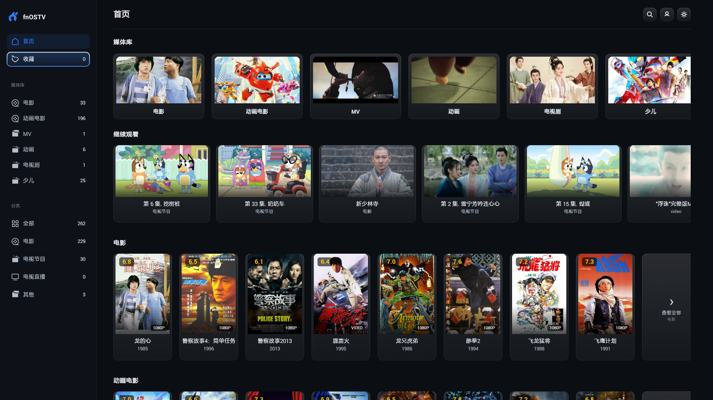
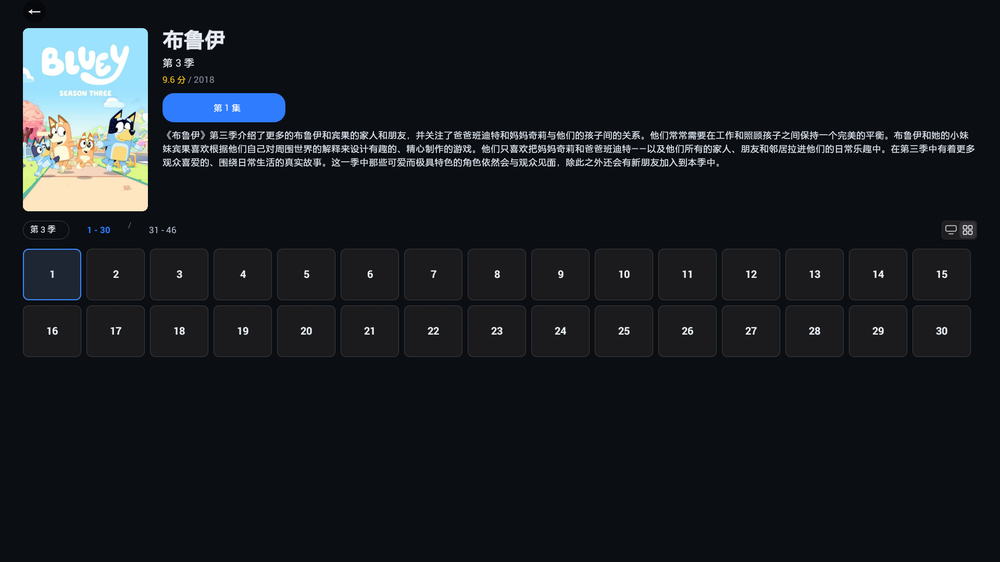
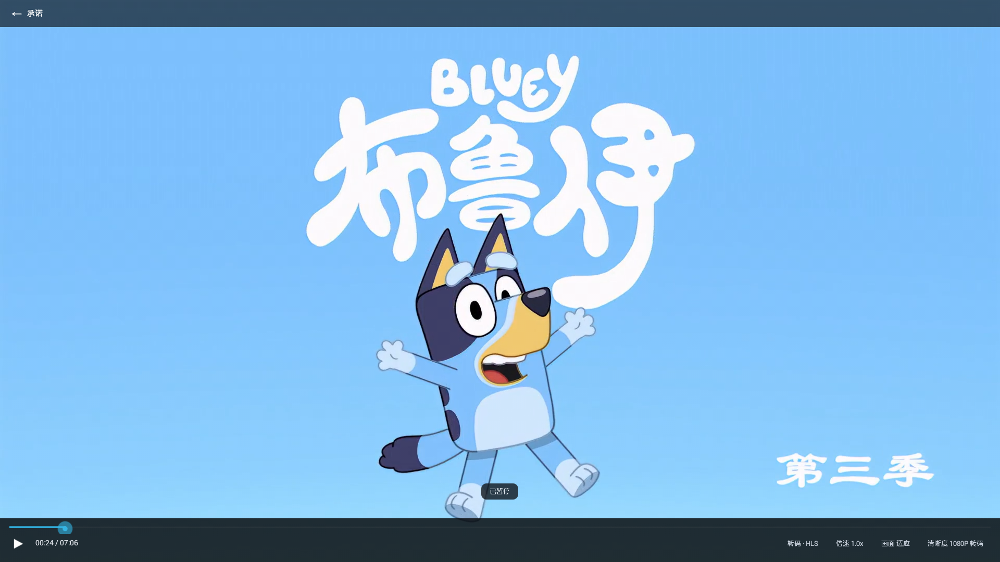
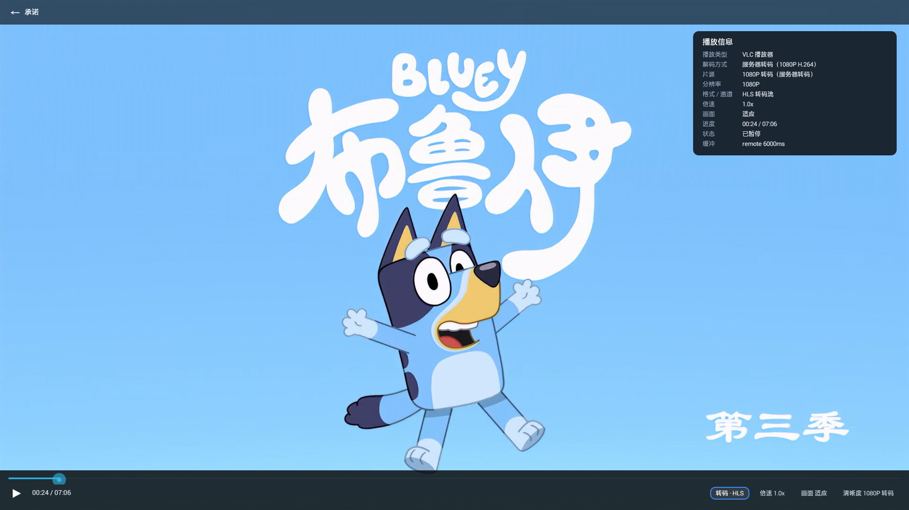

# fnOSTV Android（TV 原生客户端）

> **项目来源**：本项目基于 [**XG-China/fnOSTV**](https://github.com/XG-China/fnOSTV) **二次开发**而来（MIT 协议）。
> 上游版权归 **XG-China** 所有（其自身又基于 [XDORG-N1/fnOSTV](https://github.com/XDORG-N1/fnOSTV) 开发，二者署名均需保留）；
> 本仓库在上游基础上针对 Android 4.4 电视与低性能平板做了播放层与交互上的个人修改，本版改动见下方「本版新增内容」。
> 使用、分发或再次二开时，请保留上游的 MIT 许可文本与署名。

面向 **Android 4.4 电视/盒子**的飞牛影视（fnOS）轻量原生客户端。界面全部用原生 View 手写，
不依赖 WebView、Kotlin、Compose 或 AndroidX；播放为双引擎（电视硬解 + LibVLC 兜底），遥控器全程可操作。

- 包名：`com.fnostv.android4`
- 版本：`1.0.5`（个人修改版 · TextureView 播放层 · versionCode 35）
- 最低系统：**Android 4.2 / API 17**（重点适配 Android 4.4 电视）
- 编译/目标：API 28
- 体积：release APK ≈ 17MB（17,844,918 B；只打包 `armeabi-v7a`，主要体积是 `libvlc.so`）
- 协议：MIT

---

## 界面预览

| 首页 | 剧集页 |
| --- | --- |
|  |  |

| 播放器（HUD） | 播放信息面板 |
| --- | --- |
|  |  |

> 上面四张是早期版本界面截图，仅用于了解整体布局；本版新增的侧栏折叠、媒体库横幅海报、右侧竖排选集面板以实机为准。

- 首页：媒体库、继续观看、各分区横向卡片，全部来自服务端
- 剧集页：对齐网页 `/v/tv/season/:guid`，季海报 + 简介 + 评分/清晰度角标 + 集数方格
- 播放器：底部工具栏（播放类型 / 倍速 / 画面 / 清晰度），上键可用遥控器聚焦
- 播放信息：播放类型、解码方式、片源、分辨率、格式/通道、进度、状态、缓冲（全中文）

---

## 功能一览

- 登录：直接填 `IP:端口` 或 `域名:端口`，可勾选 **HTTPS** 与 **信任自签名证书**
- 首页：媒体库卡片 + 继续观看 + 各媒体库分区（**全部来自服务端**，一行可左右滚动，行尾有「查看全部」）
- 分类：全部 / 电影 / 电视节目 / 电视直播 / 其他、收藏、搜索
- 详情页：海报、评分、年份、简介、剧集/版本、播放源切换、收藏
- 播放：原画直连走电视硬解（4K HEVC/H.264），转码流与特殊容器走 LibVLC；失败自动回退，自动重试
- 播放器：播放类型按钮（硬解/软解/转码）、播放信息面板（长按确认或工具栏进入）、右侧竖排选集面板（按「下」呼出）
- 选集缩略图：可视区域即时加载，滑动实时补图，缺失剧照自动兜底
- 电视直播：支持 IPTV 播单（m3u / txt，http(s) 或本地文件），左栏固定分类（央视频道/卫视频道/电影频道/数字频道/儿童频道/地方频道/综艺频道/纪录频道）、右栏频道列表（带台标），背后直接播放；选台/掉线自动重连
- 稳定性：电视刚重启过会自动进入「安全模式」（改用 VLC 解码），避免同一片源反复把电视拖崩
- 设置：播放偏好（自动连播、硬件解码优先）、外观（深色/浅色/日升日落 + 卡片角标）、关于
- 遥控器：暂停/快进快退/倍速/画面模式/清晰度/数字键跳转；上键聚焦工具栏，长按确认看播放信息

## 下载

- **[`fnOSTV-1.0.5-TextureView.apk`](https://github.com/xq-china/fnOSTV/releases/download/fnOSTV-1.0.5-TextureView-v52/fnOSTV-1.0.5-TextureView.apk)** — 成品包，覆盖安装即可（保留登录态）
- **[`源代码 (zip)`](https://github.com/xq-china/fnOSTV/archive/refs/tags/fnOSTV-1.0.5-TextureView-v52.zip)** — 解压可直接继续开发
- **[`源代码 (tar.gz)`](https://github.com/xq-china/fnOSTV/archive/refs/tags/fnOSTV-1.0.5-TextureView-v52.tar.gz)** — 与 zip 内容相同，二选一

也可以直接进 [发行版页面](https://github.com/xq-china/fnOSTV/releases/latest) 下载。

文件命名规则：产物文件名只写播放层（`TextureView` / `SurfaceView`），版本号只写在标签上，例如 `fnOSTV-1.0.5-TextureView-v52`。

## 编译与安装

依赖：JDK 11、Android SDK（platform 28 与 build-tools）、Gradle 6.9（仓库未附带 gradlew）。

```bash
export JAVA_HOME=/路径/jdk-11
export ANDROID_SDK_ROOT=/路径/android-sdk
gradle assembleDebug --no-daemon
# 产物：app/build/outputs/apk/debug/app-debug.apk
```

装到设备（adb 需先连接）：

```bash
adb connect <设备IP>:5555
adb install -r app/build/outputs/apk/debug/app-debug.apk
```

看日志：

```bash
adb logcat | grep -i fnostv
```

出签名包：

先按下面「签名与出包」准备好证书与 `keystore.properties`，再：

```bash
gradle assembleRelease --no-daemon
# 产物：app/build/outputs/apk/release/app-release.apk
```

没有 `keystore.properties` 时 `assembleRelease` 只会产出 `app-release-unsigned.apk`，这个包不能被设备安装。

Windows 下 `scripts/` 里有等价的 .cmd / .ps1 脚本，按需选用。

## 签名与出包

源码包里**不含**签名相关文件——`signing/`、`keystore.properties`、`local.properties` 都在 `.gitignore` 里，不会被打包。所以解压后不能直接出签名包，需要自己补上：

1. **release 证书**：跑 `scripts\create-release-keystore.cmd`（Windows）或对应 `.ps1`，会在 `signing/` 下生成 `fnostv-release.jks` 并自动写好 `keystore.properties`
2. **`keystore.properties`** 需有四项：`storeFile`、`storePassword`、`keyAlias`、`keyPassword`——`app/build.gradle` 读的就是这四个键
3. **出包**：`gradle assembleRelease --no-daemon`，产物在 `app/build/outputs/apk/release/`

debug 包读的是 `signing/debug.keystore`（口令 `android`，别名 `androiddebugkey`），这个文件同样不在源码包里。只是想本地编译调试的话，随便生成一个即可：

```bash
keytool -genkeypair -keystore signing/debug.keystore -storepass android \
  -keypass android -alias androiddebugkey -keyalg RSA -keysize 2048 -validity 3650 \
  -dname "CN=Android Debug,O=Android,C=US"
```

注意 debug 和 release 签名不同：**已装 release 版想覆盖升级，必须用同一份 release 证书**，否则要先卸载。

## 本版新增内容（相对 XG-China/fnOSTV）

- **界面**：侧栏折叠（260dp ↔ 64dp）、媒体库横幅海报布局 + 文件夹角标、卡片标题；选集面板右侧竖排、当前集蓝框
- **手势**：单击切控制条、双击暂停、左右滑 seek、长按 1.5x/2x 加速、左半屏竖滑亮度、右半屏竖滑音量、最右 0.5cm 静默区
- **交互**：播放页跟随系统自动旋转开关、切后台自动暂停、回前台续播

> `.tooling/`、`local.properties`、`keystore.properties`、`signing/`、`app/build/` 都是本地产物，
> 已在 `.gitignore` 中排除，不会进入源码包。

## 文档

| 文档 | 内容 |
| --- | --- |
| [docs/USER_GUIDE.md](docs/USER_GUIDE.md) | 电视端使用说明：安装、登录、遥控器按键、常见问题 |
| [docs/DEVELOPMENT.md](docs/DEVELOPMENT.md) | 开发说明：架构、目录、关键流程、扩展方式、构建与调试 |
| [docs/CHANGELOG.md](docs/CHANGELOG.md) | 近期重构与行为变更记录 |
| [`fnOSTV-1.0.5-TextureView-src.zip`](https://github.com/xq-china/fnOSTV/archive/refs/tags/fnOSTV-1.0.5-TextureView-v52.zip) | 源码压缩包（可直接解压继续开发） |
| [`fnOSTV-1.0.5-TextureView.apk`](https://github.com/xq-china/fnOSTV/releases/download/fnOSTV-1.0.5-TextureView-v52/fnOSTV-1.0.5-TextureView.apk) | 成品 APK |
| [docs/fnos-interface-map.md](docs/fnos-interface-map.md) | fnOS 接口梳理（历史资料） |
| [RELEASE_NOTES.md](RELEASE_NOTES.md) | 当前版本能力与已知限制 |
| [OPEN_SOURCE.md](OPEN_SOURCE.md) / [NOTICE](NOTICE) | 开源使用与第三方组件声明 |

## 目录结构（简述）

```text
app/src/main/java/com/fnostv/android4
├── MainActivity.java        首页/列表/详情/播放的总调度
├── SettingsActivity.java    登录与设置
├── config/                  服务器配置、校验、持久化
├── net/                     RPC(WebSocket)、REST、会话、收藏/最近播放
├── media/                   影视中心网关、分类器、索引存储
├── player/                  播放器抽象、系统硬解引擎、VLC 引擎、播放策略
├── tv/                      遥控器按键分发与返回栈
├── ui/                      全部原生界面与主题组件
└── util/                    偏好、常量、日志
```

## 已知限制

- 仅打包 `armeabi-v7a`；如需在 arm64 设备上运行请自行加回 ABI（会显著增大体积）。
- 4K HEVC 的 **MP4** 直连会让 MTK 芯片的电视固件重启，已自动改为 1080P 转码；MKV 封装的 4K HEVC 可原画直连（仅限原生 4K 电视，平板不支持 4K）。
- 4K H.264 转码流在 4.4 上软解跟不上，因此转码分辨率固定 1080P。
- 收藏以本地为主，并与服务端收藏合并展示；服务端收藏的增删目前在网页端完成。
- 服务器管理类功能（媒体库管理、任务计划、用户管理）不在 TV 端提供。

## 开源协议

MIT License，详见 [LICENSE](LICENSE)。第三方组件（LibVLC / OkHttp 等）声明见 [NOTICE](NOTICE)。
